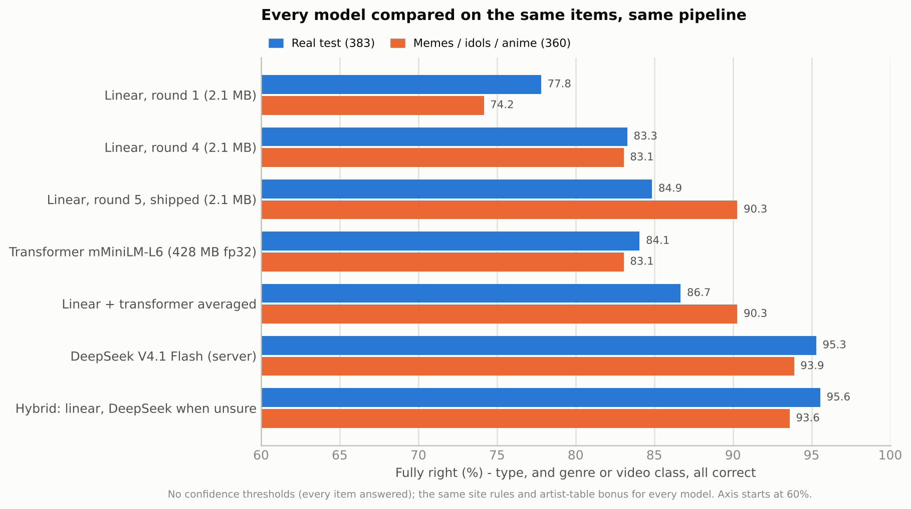
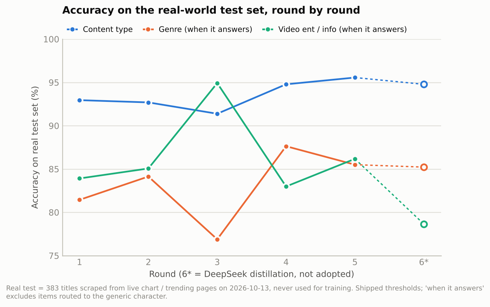
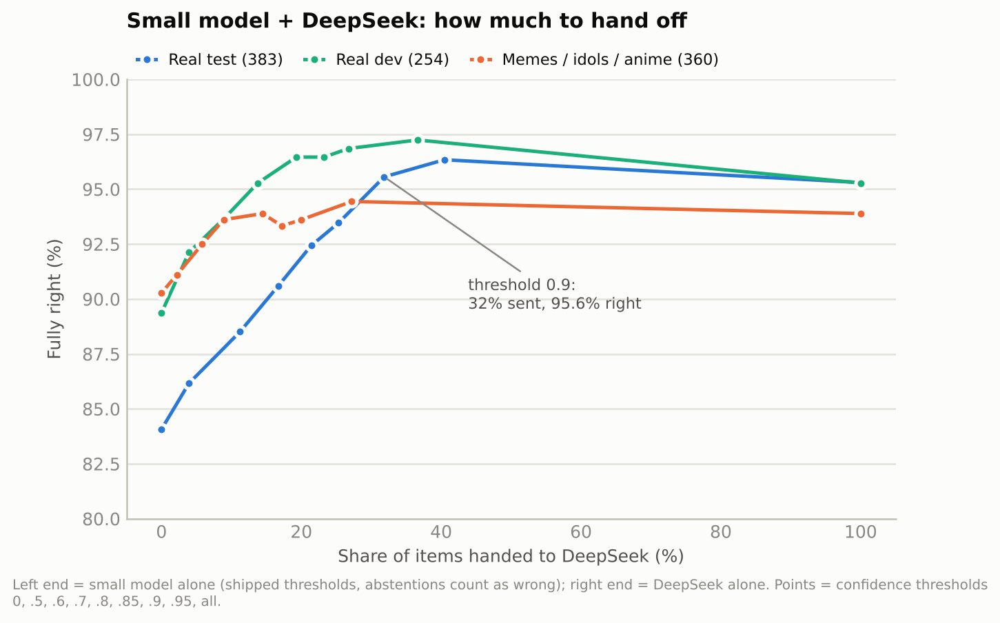
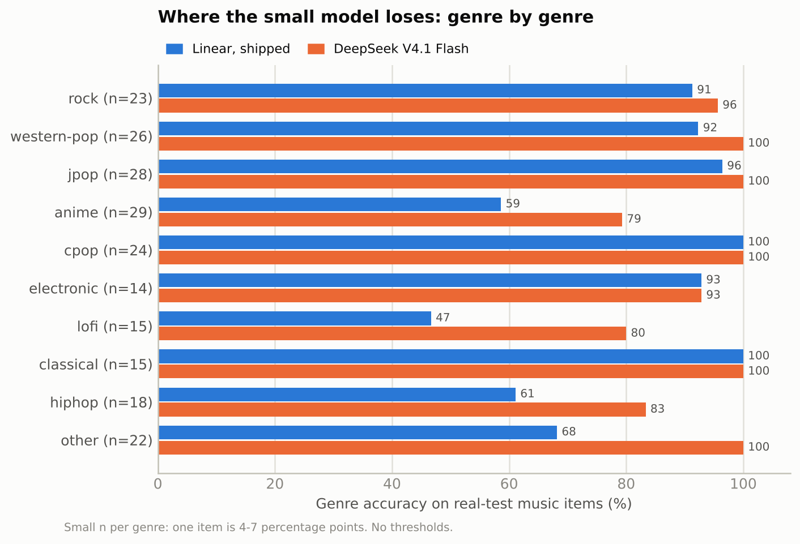
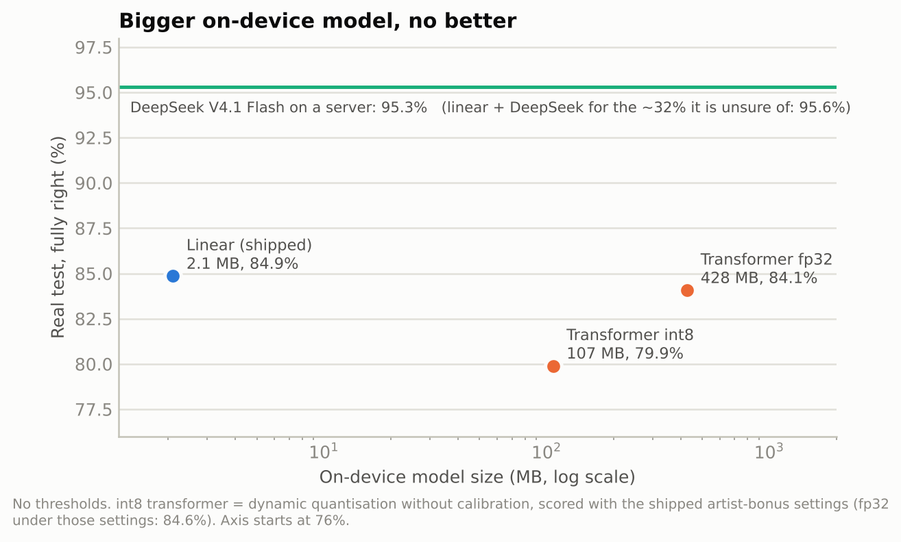
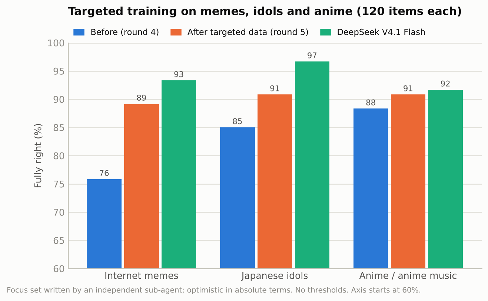
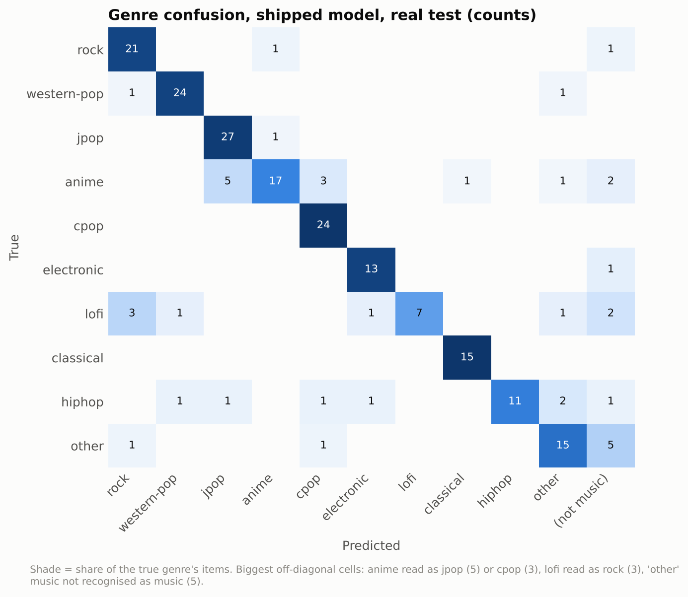

<div align="center">

# Kobutai Model 1.0

**A 2 MB on-device classifier that tells what you're playing from the title alone.**<br>
**一个 2 MB 的端侧分类器：只看标题，就知道你在放什么。**

[English](#english) · [中文](#中文) · [Kobutai extension 扩展](https://github.com/xingaobio/kobutai) · [Website 官网](https://kobutai.pages.dev) · [Paper 论文](paper/kobutai-paper.pdf)




</div>

---

<a id="english"></a>

## English

[Kobutai](https://kobutai.pages.dev) is a browser extension that puts a little chibi performer on screen to match what you're playing. It can't hear the audio; it only sees text: the title, the artist or channel, the site, and sometimes the duration. **Kobutai Model 1.0** turns that text into:

| Output | Values |
|---|---|
| Content type | music · video · live · podcast (or "not sure") |
| Genre (music) | rock · western-pop · jpop · anime · cpop · electronic · lofi · classical · hiphop · other |
| Video kind (video) | entertainment · explainer |

It was designed, trained and evaluated in seven rounds on 13 October 2026. This repository is the full research record: report, timeline, charts, every number as CSV, parameters, three model versions and the code.

### Results

On **383 real titles** scraped from that day's charts and trending pages, never seen in training:

| Approach | Size | Fully right* |
|---|---|---|
| Linear model, round 1 | 2.1 MB | 77.8% |
| **Linear model, round 5 (this release)** | 2.1 MB | **84.9%** |
| Multilingual Transformer (mMiniLMv2-L6) | 428 MB · int8 107 MB | 84.1% |
| DeepSeek V4.1 Flash (server, same text) | — | 95.3% |
| **Linear + DeepSeek, only when the small model is unsure (32%)** | 2.1 MB + server | **95.6%** |

\* Type right, and for music the genre, for video the kind. Content type alone: 95.6%.

<table><tr>
<td></td>
<td></td>
</tr><tr>
<td></td>
<td></td>
</tr></table>

### What we learned

1. **Synthetic test sets flatter you.** A validation set written by the same LLM that wrote the training data showed 97.5% in round 1; real chart titles showed about 81% for genre.
2. **The remaining errors are missing knowledge, not missing capacity.** Distilling DeepSeek into the small model didn't help, and neither did a 100M-parameter Transformer: both negative results are in the report.
3. **Keep knowledge where it can be updated.** The artist table (25,826 names) is the most effective on-device part and can be refreshed without retraining.
4. **A hybrid wins.** Let the small model answer when it's confident and hand over only the uncertain third; that beats sending everything to the large model.

### How it works

```
title, artist, site, duration
  → normalise → site rules → artist table (+3 to that genre) → linear model → confidence thresholds
```

Features are 1–4 character n-grams of title and artist, ASCII words and word pairs, site and duration bucket, hashed with FNV-1a into 131,072 buckets. Three logistic-regression heads, int8-quantised: 2,097,256 bytes. Inference is lookup, sum and softmax, under 1 ms in Node. The TypeScript runtime matches the Python reference on all 559 test vectors.

### Repository

| Path | Contents |
|---|---|
| [`REPORT.md`](REPORT.md) | Full research report (Chinese): problem, method, data, 7 rounds, results, negative results, lessons, limits, reproduction |
| [`TIMELINE.md`](TIMELINE.md) | What happened when, and why each decision was made (Chinese) |
| [`charts/`](charts) | 9 charts |
| [`results/`](results) | Every number in the report as CSV |
| [`params/`](params) | Full parameters of the linear model, the Transformer experiment and the DeepSeek teacher |
| [`models/`](models) | Rounds 1, 4 and 5; **`iter5` is Kobutai Model 1.0** |
| [`kobutai-classifier/`](kobutai-classifier) | Project: labelling spec, algorithm spec, training and evaluation code, runtimes (TypeScript, Python, Swift, C#), experiments, per-round metrics |
| [`scripts/`](scripts) | Recompute every result and redraw every chart |

### Use it

```ts
import { Classifier } from "./kobutai-classifier/runtime/ts/src/classifier";
const clf = Classifier.load(config, modelArrayBuffer, artistsTsvText);
clf.classify({ title: "Wonderwall - Remastered", artist: "Oasis", source: "open.spotify.com" });
// → { type: "music", genre: "rock", ... }
```

Algorithm and file format: [`kobutai-classifier/spec/SPEC.md`](kobutai-classifier/spec/SPEC.md). The Swift and C# ports are written but have not been compiled or run yet.

### Data note

This public version keeps the training data written by language models (about 13,000 rows of titles, plus the artist lists) and the synthetic validation and focus sets. It **leaves out data collected from other websites**: Apple's public genre charts, Bilibili and YouTube trending lists, the 637-title real-world dev/test set, the unlabelled pools and DeepSeek's answers on them. Training with only what's here works but will not reproduce the numbers exactly. The released model weights were trained with all of it; the terms of Apple's chart feed haven't been checked, so treat the weights as non-commercial until they are.

### Credits and licence

- Project lead: **Xin Gao**. Implementation and experiments: Claude (Anthropic) in Claude Code; data generation by Claude Sonnet sub-agents; teacher model DeepSeek V4.1 Flash on a self-hosted endpoint.
- Code: MIT ([`LICENSE`](LICENSE)). Report, charts, data and model weights: CC BY 4.0 ([`LICENSE-CC-BY-4.0.md`](LICENSE-CC-BY-4.0.md)), subject to the data note above.

---

<a id="中文"></a>

## 中文

[Kobutai 小舞台](https://kobutai.pages.dev) 是一个浏览器扩展：你放什么，就派一个对应的 Q 版小角色出场。它听不到声音，只能读到文字：标题、歌手或频道、网站，有时还有时长。**Kobutai 模型 1.0** 把这些文字变成：

| 输出 | 取值 |
|---|---|
| 内容类型 | 音乐 · 视频 · 直播 · 播客（或"没把握"） |
| 曲风（音乐） | 摇滚 · 欧美流行 · J-pop · 动漫 · 华语 · 电子 · Lo-fi · 古典 · 说唱 · 其他 |
| 视频类别（视频） | 娱乐 · 讲解 |

模型在 2026 年 10 月 13 日一天内经过 7 轮设计、训练和评估。这个仓库是完整的研究记录：报告、过程、图表、所有数字的 CSV、参数、三个版本的模型和代码。

### 结果

在 **383 条**当天从榜单和热门页抓取、训练时从没见过的真实标题上：

| 方案 | 体积 | 完全判对* |
|---|---|---|
| 线性模型，第 1 轮 | 2.1 MB | 77.8% |
| **线性模型，第 5 轮（本版本）** | 2.1 MB | **84.9%** |
| 多语言 Transformer（mMiniLMv2-L6） | 428 MB · int8 107 MB | 84.1% |
| DeepSeek V4.1 Flash（服务器，同样只看文字） | — | 95.3% |
| **线性 + DeepSeek，只把没把握的 32% 交出去** | 2.1 MB + 服务器 | **95.6%** |

\* 类型对，且音乐的曲风、视频的类别也对。只看内容类型：95.6%。

<table><tr>
<td></td>
<td></td>
</tr></table>

### 学到的事

1. **合成测试集会骗人。** 和训练数据出自同一个大模型的验证集，第 1 轮就显示 97.5%；真实榜单标题上曲风只有约 81%。
2. **剩下的错误是缺知识，不是缺容量。** 把 DeepSeek 蒸馏进小模型没有提升，换成 1 亿参数的 Transformer 也没有提升，两个负结果都写在报告里。
3. **知识放在可以更新的地方。** 歌手表（25,826 个名字）是端侧最有效的部件，而且不用重新训练就能更新。
4. **混合方案最好。** 小模型自信时自己判断，只把没把握的三分之一交给大模型，比全部交给大模型还准。

### 原理

```
标题、歌手、网站、时长
  → 规范化 → 站点规则 → 歌手表（该曲风 +3）→ 线性模型 → 置信度阈值
```

特征是标题和歌手的 1～4 字符 n-gram、英文单词和词对、网站和时长档位，用 FNV-1a 哈希到 131,072 个桶。三个逻辑回归输出头，int8 量化后 2,097,256 字节。推理只是"查表、求和、softmax"，Node 里每条不到 1 毫秒。TypeScript 版和 Python 参考实现在 559 条测试用例上逐条一致。

### 仓库内容

| 位置 | 内容 |
|---|---|
| [`REPORT.md`](REPORT.md) | 完整研究报告：问题、方法、数据、7 轮实验、结果、负结果、经验、局限、复现 |
| [`TIMELINE.md`](TIMELINE.md) | 按时间的过程记录和每个决策 |
| [`charts/`](charts) | 9 张图 |
| [`results/`](results) | 报告里所有数字的 CSV |
| [`params/`](params) | 线性模型、Transformer 实验、DeepSeek 教师的完整参数 |
| [`models/`](models) | 第 1、4、5 轮模型；**`iter5` 就是 Kobutai 模型 1.0** |
| [`kobutai-classifier/`](kobutai-classifier) | 项目本体：标签规范、算法规范、训练和评估代码、四种语言的推理代码（TypeScript、Python、Swift、C#）、实验、逐轮指标 |
| [`scripts/`](scripts) | 重算全部结果、重画全部图表 |

用法见上方英文部分的代码示例；算法和文件格式见 [`kobutai-classifier/spec/SPEC.md`](kobutai-classifier/spec/SPEC.md)。Swift 和 C# 版已写好，但还没编译运行过。

### 数据说明

公开版保留了由大模型编写的训练数据（约 13,000 行标题和歌手名单），以及合成验证集和专项集；**去掉了从其他网站收集的数据**：Apple 公开曲风榜单、B 站和 YouTube 热门列表、637 条真实开发/测试集、未标注的数据池和 DeepSeek 对它们的回答。只用公开数据可以训练，但不能完全复现报告里的数字。发布的模型权重是用全部数据训练的；Apple 榜单接口的使用条款还没核实，在核实之前请只做非商业使用。

### 致谢与许可

- 项目负责人：**Xin Gao**。实现与实验：Claude（Anthropic），在 Claude Code 中完成；数据由 Claude Sonnet 子代理生成；教师模型为作者自建端点上的 DeepSeek V4.1 Flash。
- 代码：MIT（[`LICENSE`](LICENSE)）。报告、图表、数据和模型权重：CC BY 4.0（[`LICENSE-CC-BY-4.0.md`](LICENSE-CC-BY-4.0.md)），并受上面"数据说明"约束。
