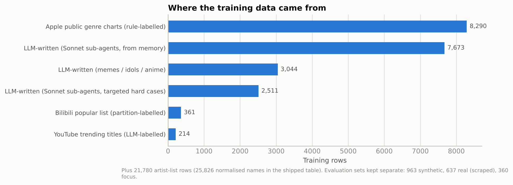
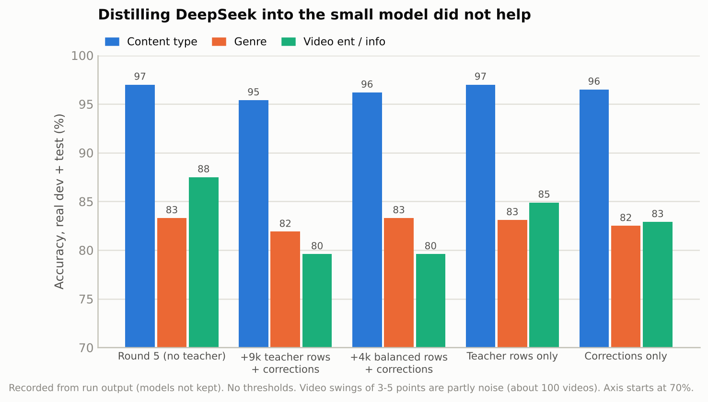

# 端侧多语言媒体内容分类器：从 2 MB 线性模型到 DeepSeek 蒸馏与 Transformer 对比

**项目**：Kobutai（浏览器扩展，原名 HappyDesk）的内容识别模块
**作者**：Xin Gao（项目负责人）；实现与实验由 Claude（Anthropic）在 Claude Code 环境中完成，数据生成使用 Claude Sonnet 子代理，教师模型为作者自建的 DeepSeek V4.1 Flash 端点
**时间**：2026 年 10 月 13 日（00:21–15:40，英国时间），共 7 轮
**代码与数据**：本仓库的 `kobutai-classifier/`。公开版去掉了从网站抓取的第三方数据，见 README 的"数据说明"

---

## 摘要

Kobutai 需要根据"正在播放什么"选择出场角色，但扩展只能读到文字元数据（标题、歌手或频道、网站、时长），读不到音频。本项目设计并训练了一个可在浏览器、macOS、Windows 三端共用的离线分类器，输出内容类型（音乐、视频、直播、播客）、10 类曲风和视频的娱乐/讲解二分类。

- **最终交付模型**：字符 n-gram 哈希 + 线性分类（三个输出头），int8 量化后 2.1 MB，加 0.48 MB 歌手表；单条推理不到 1 ms（0.85～0.97 ms）；TypeScript 版与 Python 参考实现在 559 条测试用例上逐条一致。
- **真实世界表现**：在 383 条从当天榜单和热门页抓取、训练时从未见过的真实标题上，完全判对 84.9%（不设阈值），内容类型 95.6%。
- **DeepSeek V4.1 Flash 作为教师**：同样只看文字，真实测试集完全判对 95.3%。
- **两个负结果**：把教师标签蒸馏进小模型没有提升；换成 1.07 亿参数的多语言 Transformer（mMiniLMv2-L6）也没有提升（84.1%），体积却大 50～200 倍。
- **有效方案**：小模型自信时自己判断，不自信（置信度 < 0.9）时交给 DeepSeek，只转交约 32% 的内容，真实测试集完全判对 95.6%，略高于全部交给 DeepSeek。

核心结论：剩下的错误主要来自"文字里没有答案"（新歌手、无线索的标题），这是知识问题而不是模型容量问题。端侧模型应保持小而快，知识交给可更新的歌手表和服务器端大模型。


---

## 1. 问题

| 约束 | 含义 |
|---|---|
| 只有文字 | 标题、歌手或频道名、网站域名、时长；没有音频（录系统音频需要额外授权且耗电） |
| 三语 | 主要用户说英语、日语、中文，标题常常混排 |
| 三个平台 | Chrome 扩展（TypeScript）、macOS（Swift）、Windows（C#），结果必须一致 |
| 小而快 | 扩展包里能放得下，每次切歌都要判断 |
| 可以不判断 | 没把握时返回空，由通用角色"小喜"出场；错判的代价是选错角色，用户可以"换一次" |

输出标签：

- 类型 `type`：music / video / live / podcast
- 曲风 `genre`（仅音乐）：rock、western-pop（含 K-pop、R&B）、jpop、anime（含 Vocaloid、VTuber、游戏音乐）、cpop、electronic、lofi（含环境音、助眠）、classical（含影视配乐）、hiphop、other（爵士、乡村、民谣、演歌、儿歌等）
- 视频类 `vclass`（仅视频）：ent（娱乐）/ info（讲解）

完整定义见 `kobutai-classifier/spec/LABELING.md`。

## 2. 方法

### 2.1 流程

```
采集信号 → 文本规范化 → ① 站点规则 → ② 歌手表 → ③ 小模型 → ④ 置信度阈值 → 角色池
                                                         └─(可选) 不自信时交给 DeepSeek
```

1. **站点规则**：纯音乐站一定是音乐，播客站一定是播客，影视和课程站只能是视频，时长无限（直播）只在音乐和直播之间选。
2. **歌手表**：25,826 个规范化名字 → 曲风。命中时给对应曲风的分数加 3（加分而不是覆盖，标题里的"TVアニメ OP"之类线索仍能改判）。
3. **小模型**：见下。
4. **阈值**：类型 0.4、曲风 0.3、视频类 0.5，在真实开发集上调出。

### 2.2 交付的小模型

| 项目 | 设置 |
|---|---|
| 特征 | 标题和歌手各取前 160 个码位，1～4 字符 n-gram（带首尾标记）；ASCII 单词和相邻词对；网站、时长档位、网站×时长 |
| 规范化 | NFKD、去组合符、ASCII 小写、合并空白 |
| 哈希 | FNV-1a 32 位，取低 17 位（131,072 个桶） |
| 分类器 | 多项逻辑回归，三个头，C=30，类别平衡权重，scikit-learn lbfgs |
| 增强 | 每行再加一份：35% 去掉歌手、50% 时长改为未知、15% 去掉网站 |
| 量化 | 每个头一个缩放系数，对称 int8；偏置 float32 |
| 体积与速度 | 2,097,256 字节；Node 中单条 0.85～0.97 ms（不同次测量） |

为什么不用现成方案：按音频分类的模型拿不到音频；通用多语言句向量模型"懂文字不懂音乐"；Create ML 文本分类器没有可靠的 ONNX 导出，而 ONNX 浏览器运行库本身就有十几 MB。线性模型的推理只是"查表 + 求和 + softmax"，三种语言各写几十行即可，并用同一份测试用例保证逐条一致（`kobutai-classifier/spec/SPEC.md`）。

完整参数：`params/linear_model.json`、`params/shipped_config.json`。

## 3. 数据

### 3.1 训练数据



| 来源 | 行数 | 说明 |
|---|---|---|
| Sonnet 子代理凭记忆编写 | 7,673 | 按语言和平台分片（中日英音乐站、YouTube、B 站、娱乐/讲解视频、直播、播客），首批 20 个子代理并行 |
| 子代理针对难例编写 | 2,511 | 歌单/作業用BGM、DJ 现场、助眠音、翻唱、Spotify 上的播客、财经和软件教程、不带类别词的热门标题 |
| 子代理编写：热梗、日本偶像、日番 | 3,044 | 第 5 轮专项 |
| Apple 公开分类榜单 | 8,290 | 12 个地区 × 29 个曲风榜，按规则映射到 10 类；与人工歌手名单冲突时以人工为准 |
| B 站热门列表 | 361 | 按分区映射娱乐/讲解 |
| YouTube 热门标题 | 214 | 子代理逐条人工标注 |
| 合计 | 22,093 | 去除与任何评估集重复的标题后实际使用 21,377 行 |

歌手名单 21,780 行（子代理按曲风和地区分片编写 + Apple 榜单统计），合并、去重、解决冲突后为 25,826 个规范化名字。

### 3.2 评估数据（与训练严格分开）

| 评估集 | 行数 | 怎么来的 | 用途 |
|---|---|---|---|
| 合成验证集 | 963（中日英各约 320） | 独立子代理凭记忆编写，写作时不允许读取训练数据 | 回归检查。和训练数据同源，分数偏高 |
| **真实测试集** | 637（开发 254 / 测试 383） | 子代理联网抓取 2026-10-13 当天的榜单、热门页、播客榜（网易云、Billboard JAPAN、kworb、B 站、Apple 播客等），带来源 URL | **主要指标**。开发部分用于调阈值和看错例，测试部分只用来报数 |
| 专项集 | 360（热梗、日本偶像、日番各 120） | 独立子代理编写，少量当季番名来自网页 | 第 5 轮专项评估 |

开发/测试按"歌手|标题"的 FNV-1a 哈希固定拆分（2:3）。从第 4 轮起，训练时自动剔除与任何评估集标题相同的行（共 716 行）。

## 4. 实验过程（7 轮）

完整记录见 `TIMELINE.md` 和 `kobutai-classifier/LOOP.md`。下表"真实测试"一栏为当轮实际交付配置（含阈值）的成绩。


| 轮 | 做了什么 | 真实测试：类型 / 曲风（覆盖率）/ 视频 | 结论 |
|---|---|---|---|
| 1 | 规范、20 个子代理生成数据、基线模型 | 93.0 / 81.4（91%）/ 83.9 | 合成集上 97.5% 已"达标"，但表里查不到歌手的音乐只有 91%，怀疑虚高 |
| 2 | 抓取真实测试集；中小歌手 +2,000；难例 +1,161 | 92.7 / 84.1（88%）/ 85.1 | 真实数据揭示了合成集的虚高（曲风差约 13 个点） |
| 3 | Apple 榜单：歌手 +6,500、歌曲 +7,100（榜单下载完成前的数字；全部下载后为 14,223 位歌手、8,290 首歌）；阈值改在真实开发集上调 | 91.4 / 76.9（87%）/ 94.9（覆盖仅 63%） | 测试集下跌。消融显示榜单数据本身有益（+2.5 分），问题在阈值和榜单曲风定义（见 §6.3） |
| 4 | 人工名单覆盖榜单标签；B 站和 YouTube 真实热门标题；"不带类别词"的视频和直播标题 1,350 条 | 94.8 / 87.6（91%）/ 83.0 | 冲突从 471 降到 72；试过哈希表加倍（4.2 MB），提升在误差内，未采用 |
| 5 | 热梗 1,420、日本偶像 717 + 212 团体名、日番 907 + 352 歌手 | **95.6 / 85.5（93%）/ 86.2** | 专项集完全判对 75.8→89.2（热梗）、85.0→90.8（偶像）、88.3→90.8（日番）。**交付版本** |
| 6 | DeepSeek V4.1 Flash 当教师：对比、蒸馏、标签复核、混合方案 | 蒸馏后 93.7 / 84.2 / 80.2 | 蒸馏无效，回退；混合方案有效（§5.3） |
| 7 | 换成小型多语言 Transformer | 不设阈值完全判对 84.1%（线性 84.9%） | 无效，未采用（§6.2） |

## 5. 主要结果

### 5.1 所有模型在同一批数据、同一流程下对比（不设阈值）

| 模型 | 体积 | 真实测试（383） | 真实开发（254） | 专项（360） | 合成（963） |
|---|---|---|---|---|---|
| 线性，第 1 轮 | 2.1 MB | 77.8 | 79.9 | 74.2 | 94.7 |
| 线性，第 4 轮 | 2.1 MB | 83.3 | 90.2 | 83.1 | 95.2 |
| **线性，第 5 轮（交付）** | 2.1 MB | **84.9** | 89.4 | **90.3** | 94.9 |
| Transformer（mMiniLMv2-L6） | 428 MB（int8 107 MB） | 84.1 | 85.0 | 83.1 | 84.7 |
| 线性 + Transformer 平均 | 430 MB | 86.7 | 90.6 | 90.3 | 93.9 |
| DeepSeek V4.1 Flash | 服务器 | 95.3 | 95.3 | 93.9 | 98.3 |
| **线性 + DeepSeek（不自信时转交）** | 2.1 MB + 服务器 | **95.6** | **96.9** | 93.6 | 99.0 |

指标为"完全判对"：类型对，且音乐的曲风、视频的娱乐/讲解也对。数据：`results/model_comparison.csv`。

**本节和图 2～9 是归档时统一重算的**：所有模型都不设阈值、歌手表加分统一为"歌手字段命中 +3、标题命中 +0"，第 1、4、5 轮模型从 git 历史恢复后在同一批数据上重跑。因此和当时运行记录（`kobutai-classifier/LOOP.md`）里的数字有 0.3～2 个百分点的差别，例如交付模型在真实测试集上当时记为 84.6%，统一重算为 84.9%；Transformer 当时记为 84.6%，重算为 84.1%。结论不受影响。§4 的逐轮表使用当时的运行记录（含阈值）。

### 5.2 小模型的弱点在哪


真实测试集上，小模型在华语流行、古典（100%）、J-pop（96%）上很好；在动漫（59%）、lofi（47%）、说唱（61%）、其他（68%）上明显落后 DeepSeek。混淆矩阵显示主要错误是：动漫歌被认成 J-pop 或华语、lofi 被认成摇滚、"其他"类音乐没被认成音乐。


这些恰好是"必须认识这首歌或这个歌手才能判断"的类别：动漫主题曲经常由主流歌手演唱，标题里不一定有作品名；lofi 和说唱有大量新晋制作人。

### 5.3 混合方案：只转交不自信的部分


| 小模型置信度低于 | 转交比例 | 真实测试完全判对 |
|---|---|---|
| 不转交 | 0% | 84.1%（交付配置含阈值，弃权的 0.5% 和判错的 15.4% 都算错） |
| 0.7 | 17% | 90.6% |
| 0.8 | 21% | 92.4% |
| **0.9** | **32%** | **95.6%** |
| 0.95 | 40% | 96.3% |
| 全部转交 | 100% | 95.3% |

转交约三分之一就超过了全部交给 DeepSeek，说明小模型自信的那部分本身就很准，而且两个模型的错误不完全重合。数据：`results/hybrid_curve.csv`。

### 5.4 专项：热梗、日本偶像、日番


补数据前，热梗几乎没有训练样本（约 19,000 行里只有 63 行沾边），是三类里最弱的；补 1,420 行后提升最大（75.8% → 89.2%）。专项集也是大模型凭记忆写的，绝对值偏乐观，但前后对比可信。

## 6. 负结果

### 6.1 把 DeepSeek 蒸馏进小模型：无效



- **做法**：让 DeepSeek 给 16,299 条无标签真实标题（Apple 榜单余量、Apple 播客单集、音乐视频榜、B 站和 YouTube 热门）打标签，取置信度 ≥ 0.8 的 8,982 条加入训练；另让它复核全部 21,535 行已有标签，对有把握且不同意的 286 行做删除或改标。
- **结果**：真实数据（开发 + 测试，不设阈值）上曲风基本不变（83.3% → 81.9%～83.3%），视频娱乐/讲解下降（87.5% → 79.6%）。第一版里有四分之一的播客单集被放到 YouTube 域名上，导致 YouTube 视频被认成播客；去掉这一点并平衡类别（每个曲风最多 600 条、播客最多 1,500 条）后，视频指标仍然偏低。分开测试显示"只加新数据"对视频影响较小（84.9%），"只做标签修正"影响较大（82.9%）；真实开发和测试集合计约 150 条视频，几个点的摆动也有一部分是噪声。没有任何一种变体超过第 5 轮。
- **解释**：DeepSeek 的优势是具体知识（"这首歌是哪个乐队的""这个梗是什么"），一个 2 MB 的线性模型从几千个例子里学不进去；它能学的是表面字符模式，而这部分原有数据已经覆盖。
- **副产品**：教师对 13,245 行手写训练标签有把握且不同意的只有 89 行（0.7%），多为摇滚/流行、J-pop/动漫这类边界情况，说明原有标签质量可靠。数据：`results/teacher_audit_recorded.csv`。

### 6.2 换成小型 Transformer：无效


- **设置**：mMiniLMv2-L6-H384（从 XLM-R Large 蒸馏，多语言，1.07 亿参数，其中 9,600 万是词表嵌入）；冻结词表嵌入，训练 1,100 万参数；输入"标题 | 歌手 | 网站 | 时长档"，均值池化，三个线性头；AdamW 6e-5，batch 32，3 轮，2 核 CPU 上 37 分钟。站点规则和歌手表加分与线性模型完全相同。参数：`params/transformer_experiment.json`。
- **结果**：真实测试 84.1%（线性 84.9%），专项集和合成集明显更差；与线性模型平均后真实测试 86.7%（+1.8 分，约 7 条），在误差范围内，没达到"高出 3 分以上才值得"的预设门槛。
- **部署代价**：ONNX fp32 428 MB，int8 107 MB；int8 单条 6.6 ms；动态 int8 量化后真实测试准确率从 84.6% 降到 79.9%（两者都按交付配置的歌手加分测得）。
- **保留意见**：只在 CPU 上训练了 3 轮且冻结了词表，GPU 上训更久可能会好一些；但剩余错误的性质（缺知识）决定了上限不高。

### 6.3 其他

- **第 3 轮的"下跌"**：加入 Apple 榜单后合成集涨、真实测试集跌。不设阈值的消融显示榜单数据整体有 +2.5 分帮助（`results/ablations_recorded.csv`），下跌来自两点：阈值和歌手加分在 254 条的小开发集上调偏；Apple 的曲风定义和我们不同（例如把日本乐队归为 Rock）。第 4 轮让人工名单覆盖榜单标签后，冲突从 471 降到 72，真实曲风回升。
- **哈希表加倍（2^18，4.2 MB）**：真实曲风 +2 分左右，但在误差内，不值得体积翻倍。
- **Wikidata 歌手表**：查询接口对云环境限速到每分钟 1 次，只拿到约 3,000 条关系，未使用。脚本保留，可在本地运行。

## 7. 经验

1. **合成评估集会骗人。** 和训练数据出自同一个大模型记忆的验证集，第 1 轮就显示 97.5%；真实抓取的标题上曲风只有约 81%。从第 2 轮起所有决策都以真实测试集为准，测试部分只报数不调参。
2. **先区分"模型问题"和"知识问题"。** 用教师模型在同一输入上的上限（95%）对照，就能看出小模型缺的不是容量而是知识。两次"换更强的端侧学习方式"（蒸馏、Transformer）都验证了这一点。
3. **知识放在可更新的地方。** 歌手表是端侧最有效的部件（第 1 轮消融：去掉歌手表和对应训练行后，合成集曲风从 96.7% 降到 92.8%），且可以每周随榜单更新，不需要重新发布模型。
4. **小样本下要算误差。** 真实测试集 383 条，1 条约 0.26 个百分点；视频只有约 100 条，增加数据会改变随机增强，单是这一点就能让视频指标摆动 3 个点。所有"提升"先问是否超过噪声。
5. **规则优先于学习。** 平台本身知道的事（音乐站、播客站、Spotify 的 `/episode/` 网址）直接用规则，比任何模型都准，且零成本。
6. **数据冲突要有明确的优先级。** 人工名单 > 榜单规则 > 训练投票；不设优先级时，Apple 的曲风定义悄悄改变了标签含义。
7. **负结果同样值得记录。** 第 6、7 轮都没有改进交付模型，但它们回答了"要不要换模型"这个产品决策，并直接导向了混合方案。

## 8. 局限

- 真实测试集 383 条（音乐 214 条），小于 2 个百分点的差别不可靠。
- 真实测试集的标签由 Sonnet 子代理给出，DeepSeek 与之高度一致，部分可能来自两个大模型对边界情况的看法相近，DeepSeek 的 95% 可能略偏高。
- 训练集中榜单数据与真实测试集同一周抓取，歌手有重合。这与实际使用一致（歌手表随榜单更新），但长期不更新时成绩会回落。
- Swift 和 C# 移植版已写好但未编译运行（环境中没有对应工具链）。
- Apple 榜单接口的使用条款未核实；如需商用，可去掉这部分数据重训（真实曲风约降 2.5 分）。
- 第 6 轮的部分消融和第 3、4 轮的变体模型没有保留，数字来自当时的运行输出（`results/ablations_recorded.csv` 已注明）。

## 9. 复现

```bash
cd kobutai-classifier
python3 scripts/build_artists.py                 # 合并歌手名单
python3 train/train.py                           # 训练线性模型（2 核 CPU 约 3 分钟）
python3 train/evaluate.py --tag check            # 评估（合成 + 真实）
python3 train/make_test_vectors.py && (cd runtime/ts && npm test)   # 跨语言一致性
python3 experiments/transformer/train_tf.py      # 第 7 轮 Transformer（约 37 分钟，需 torch、transformers）
cd ../scripts && python3 collect_results.py && python3 make_charts.py   # 重算本报告的所有数字和图
```

`collect_results.py` 读取 `models/iter1|iter4|iter5`（从 git 历史恢复的三版模型）和缓存的 DeepSeek 答案，不调用任何接口。

## 10. 文件索引

| 位置 | 内容 |
|---|---|
| `REPORT.md` | 本报告 |
| `TIMELINE.md` | 按时间顺序的过程记录和每个决策 |
| `charts/` | 9 张图（PNG，180 dpi） |
| `results/` | 所有数字的 CSV：模型对比、逐轮指标、混合曲线、分曲风、混淆矩阵、专项集、消融、教师复核、数据清单、体积与速度 |
| `params/` | 线性模型、Transformer、DeepSeek 教师的完整参数；交付的 config.json |
| `models/` | 第 1、4、5 轮的模型文件（从 git 历史恢复），第 5 轮为交付版 |
| `scripts/` | 重算结果和画图的脚本 |
| `kobutai-classifier/` | 完整项目：规范、数据、训练和评估代码、三平台推理代码、实验、逐轮报告 |
| （未公开）`kobutai-classifier.git.bundle` | 完整 git 历史，含未公开的抓取数据，作者本地保存；提交时间可作为过程证明 |
